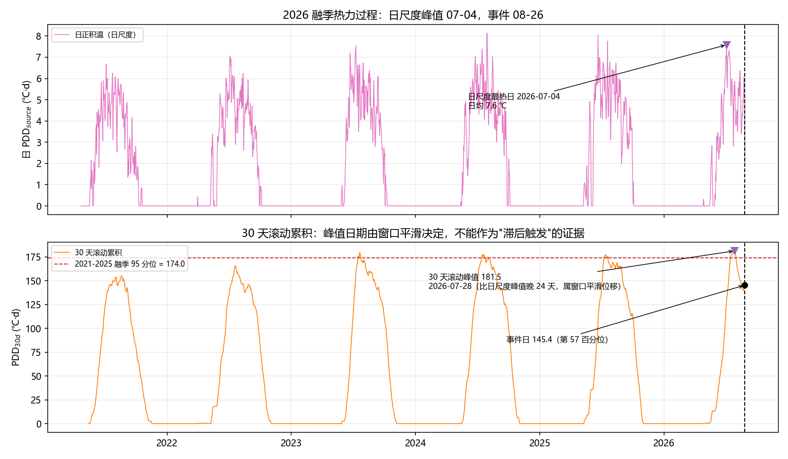

# 问题 1 分析报告：吉隆泥石流与高寒山区气象条件的关联性

## 0. 本版修订说明

本版针对上一版的三处方法性缺陷做了修正，**结论因此有实质变化**，请以本版为准：

| 上一版 | 本版 | 影响 |
|---|---|---|
| 通量/辐射日累积直接用 `sum`，缺测小时被当成 0 | 按有效小时归一化（`sum/n×24`，<18 h 记缺失） | 潜热"高 65%" → **高 26%**；z 0.93 → 0.56 |
| 事件窗 08-23~08-26（含事件当天 10:30 之后） | 事件窗 **08-23~08-25**（不含事件当天） | 去除灾后观测的污染 |
| 以"距 30 天滚动积温峰值 29 天"论证滞后机制 | 删除该论证：30 天滚动和的峰值日是窗口平滑造成的 | 见 §3.1 |
| "事件前降水 0.0 mm"作为排除降雨的证据 | 降级为中性证据（8-9 月 61.6% 的日子本来就无雨） | 见 §3.5 |
| 未检查 0.8 m 土壤湿度传感器 | 加入年际稳定性诊断与基线敏感性 | 见 §5.2 |

---

## 1. 目标、证据边界与思路

### 1.1 题目要求与本报告覆盖范围

题面要求基于 MET / RADM / SOIL / FLUX 四类逐小时观测，分析**大气边界层结构、天气过程、极端气象事件**与本次泥石流的关联性，并给出关联性最高的 5 个特征。

本报告的重心是**关联性排序**（题目的最后一句）。与之相关的边界层与极端事件证据（风切变指数、理查森数、逆温、热浪标志）随排序一并给出；天气过程（环流型、锋面）不在观测数据范围内，仅在 §3.1 用逐日温度序列加以描述。

### 1.2 事件性质：先明确"能分析什么"

题面对灾害的定性是：**尼泊尔境内高位冰崩 → 碎屑流 → 泥石流 → 山洪**的链式过程，口岸受灾。也就是说，直接激发因素是**冰崩**，不是降雨。

因此本报告能回答的是：**冰崩发生前，源区及其下游的气象条件处于什么状态**，而不是"什么触发了泥石流"。所有"关联"均为统计关联，不构成因果判定。

### 1.3 只有 1 场事件：三条互补证据线

单事件（n=1）无法训练分类器，任何"事件 vs 非事件"的监督学习都只是记住这一天。因此采用三条互补证据，再用 Borda 名次合成：

| 证据线 | 做法 | 回答的问题 | 弱点 |
|---|---|---|---|
| **A 事件窗距平** | 事件前 3 天均值 vs 2021-2025 年 8-9 月（305 天），算标准化距平 z 与百分位 | 事件时哪些要素异常 | 单事件，z 大也可能是偶然 |
| **B 代理标签** | 以"融季 PDD₃₀ ≥ 95 分位"为代理标签，算单特征 AUC | 哪些要素控制热力条件 | 标签由温度定义，温度类"作弊" |
| **C 多变量重要性** | 随机森林（仅非温度特征） | 哪些要素提供独立信息 | 重要性≠因果 |

合成方式的两点说明：

- 三条准则各自排名后取**平均名次**（Borda），再对 |r|>0.7 的特征去共线；
- 气候态列（`*_clim`）是日序的平滑函数、本质是日历代理，**不参与排序**。

---

## 2. 数据与预处理

- 4 类逐小时数据合并为 **52 584 行 × 63 变量**；剔除三个主变量（气温/风速/净辐射）全空的时刻后为 **46 768 行**；聚合为 **1 951 天 × 61 列**的日尺度主表（2021-04-23 ~ 2026-08-27）。
- 缺失哨兵 `9999.9 / -9999.0` 与 `QC_` 列统一处理（QC 列整体丢弃，见 §5.4）。
- **三条温度线**（递减率 6.5 ℃/km）：观测站 4170 m（实测）、源区 5297 m（−7.3 ℃）、口岸 1852 m（+15.1 ℃）。

### 2.1 日聚合口径（本版修正的核心）

| 类型 | 口径 | 理由 |
|---|---|---|
| 状态量（温度、湿度、含水量、α、Ri） | 日均/极值 | 直接取平均 |
| 能量与通量（LE、H、Rn、Rsd、Lnet、G） | **按有效小时归一化到 24 h**，有效小时 < 18 记缺失 | 直接 `sum` 会把缺测当 0；2021-2025 年 8-9 月有 **20% 的日子整天没有 FLUX 观测**，会把对照期均值系统性拉低 |
| 降水 | 直接 `sum`，全缺测记缺失 | 降水本身就是累积量，且缺测率 0% |

不修正时，事件窗（3 天全部 24/24 小时齐全）对比一个被压低的基线，得到"潜热高 65%"；修正后为 **+26%**（1 135 vs 899 W·m⁻²·d）。

### 2.2 数据质量

- FLUX 变量缺测率：2021 年 18%，**2022 年 49%**，2023 年 26%，2026 年 9%；按月份看 8 月 21.5%、9 月 22.1%。
- 土壤含水量传感器存在年际跳变（§5.2），因此额外派生 `dVWC_shallow`（0.1−0.4 m）作为稳健性对照。

---

## 3. 结果

### 3.1 热力过程：事件落在融季后半段，热力条件中位偏上

| 指标 | 值 |
|---|---|
| 2026 年日尺度最热日（源区日均温最高） | **2026-07-04**（日均 7.6 ℃） |
| 2026 年 30 天滚动积温峰值 | **181.5 ℃·d（2026-07-28）**，六年最高（次高 2023 年 179.8） |
| 事件日 30 天累积积温 | **145.4 ℃·d**，处 2021-2025 融季第 **56.7** 百分位 |
| 事件窗（08-23~08-25）温度距平 | **+1.17 ℃**（约第 89 百分位） |
| 2026 年 8-9 月平均温度距平 | **−0.30 ℃**（偏冷） |
| 事件前 5 天（08-15~08-19）温度距平 | **−1.20 ℃**（明显偏冷） |
| 热浪日数（7 天距平 > 2 ℃） | **0 天**（各年 8-9 月均为 0） |

**三点结论**：

1. **不存在"当日热力阈值触发"**。事件日累积积温只有第 57 百分位，比融季 95 分位阈值（174.0）低 28.6 ℃·d。
2. **2026 年"最热"只对 7 月的 30 天积分成立**。8-9 月整体比气候态低 0.30 ℃，事件窗前的 5 天还明显偏冷，热浪标志从未触发。事件窗那 3 天是一个幅度约 +1.2 ℃ 的短暖脉冲，不是极端热事件。
3. **"距峰值 29 天"不作为证据**。30 天滚动和在数学上必然把峰值推后：日尺度峰值 07-04、7 天滚动峰值 07-14、30 天滚动峰值 07-28，且**每一年的 30 天峰值都落在 7 月中下旬**。因此"事件距峰值多少天"只是日历位置，不能用来论证滞后机制。

> 若需要讨论"融水累积—滞后"假设，正确做法是针对多场事件估计滞后分布（本数据只有 1 场，无法完成），见 §5.3。

### 3.2 事件前 3 天的异常（按 |z| 排序前 10）

| 特征 | 事件窗 | 常年 | z | 百分位 |
|---|---|---|---|---|
| 表层−深层土壤湿度差 dVWC | −0.005 | −0.086 | **+1.64** | 94 |
| 饱和水汽压差 VPD | 1.07 kPa | 0.84 | +1.51 | 95 |
| 源区日积温 PDD | 5.81 | 4.17 | +1.18 | 89 |
| 净辐射日累积 Rn | 4 231 | 3 269 | +1.10 | 87 |
| 短波辐射日累积 Rsd | 7 820 | 6 254 | +1.07 | 87 |
| 日最高温 | 19.90 ℃ | 17.52 | +1.07 | 88 |
| 温度距平 | +1.17 ℃ | 0.01 | +1.06 | 89 |
| 0.8 m 土壤含水量 | 0.108 | 0.167 | −0.97 | 20 |
| 潜热通量日累积 LE | 1 135 | 899 | +0.56 | 71 |
| **3 天累积降水** | **1.2 mm** | 4.1 | −0.40 | 58 |

**读法**：事件窗是"晴天、暖、干、辐射强、蒸发需求大"的组合，深层土壤偏干，但降水并不异常。

需要特别说明 dVWC：它是 0.1 m 与 0.8 m 两层含水量之差，事件窗由 −0.086 收窄到 −0.005。拆开看，**表层 0.103（常年 0.082，z=+0.61）只是略偏湿，主要变化来自深层 0.108（常年 0.167，z=−0.97）**。所以准确的表述是"深层未获补给"，而不是"融水在表层大量聚集"。

### 3.3 代理标签（融季 PDD₃₀ ≥ 174.0，31 个正样本）与独立性

| 名次 | 特征 | AUC | 说明 |
|---|---|---|---|
| 1 | PDD_30d | 1.000 | **循环性，仅作参照，不参与排序** |
| 2 | PDD_7d | 0.875 | 同上 |
| 3 | 绝对湿度 H2O_density | 0.787 | 非温度特征中最高 |
| 4 | 夜间最低温 T\*\_min | 0.783 | 三条温度线完全共线（r=1） |
| 5 | dVWC | 0.739 | |
| 6 | 风切变指数 α | 0.724 | |

非温度特征池（剔除全部温度类）前四：绝对湿度 0.787、dVWC 0.739、风切变指数 0.724、潜热通量 0.680。

### 3.4 综合排序与最终 Top-5

三条准则的名次平均（Borda），再做 |r|>0.7 去共线（49 个候选 → 22 个独立代表）：

| 名次 | 特征 | Borda | AUC | \|z\| | RF 重要性 | 入选依据 |
|---|---|---|---|---|---|---|
| 1 | 表层−深层土壤湿度差 dVWC | 2.67 | 0.739 | **1.64** | 0.084 | 三项准则均靠前 |
| 2 | 日均气温（口岸线） | 9.83 | 0.731 | 1.07 | 0.022 | 事件偏暖 + 识别热天 |
| 3 | 绝对湿度 H2O_density | 12.67 | **0.787** | 0.36 | **0.165** | 机制一致性 + 独立信息 |
| 4 | 潜热通量日累积 LE | 14.00 | 0.680 | 0.56 | 0.029 | 机制一致性 |
| 5 | 风切变指数 α | 19.33 | 0.724 | 0.25 | 0.039 | 独立于热力（r≈0.22） |

去共线说明：三条温度线（站点/源区/口岸）互为常数平移，r=1.0，只保留一条；表中以口岸线为代表，物理含义就是**区域日均气温比常年高约 1.7 ℃**。

**三条准则的分歧必须讲清楚**：dVWC 与温度是"事件证据"（事件时确实异常）；绝对湿度、潜热通量、风切变指数是"机制证据"（能识别热天或提供独立信息，但**事件当天并不异常**）。二者不应被混为一谈，见 §3.6。

### 3.5 降水：证据中性，不能据此排除降雨

| 项目 | 值 |
|---|---|
| 事件窗日降水 | **0.0 mm**（3 天全部为 0） |
| 3 天滚动累积降水 | 1.2 mm（含 08-21~08-22 的零星降水） |
| 对照期（305 天）无雨日比例 | **61.6%**（188 天） |
| 对照期日降水中位数 | 0.0 mm |
| 降水特征的 Borda 名次 | 41 / 44（共 49 项） |

事件窗确实没有降水，但**8-9 月本来就有 61.6% 的日子不下雨**，所以"没下雨"这件事信息量很低；它既不能证明降雨触发，也不能排除。更关键的是**空间代表性**：观测站位于 4170 m，灾源在尼泊尔一侧 5000 m 以上，喜马拉雅南坡与本站所在的雨影区降水可以完全无关，本站无法代表源区。

因此本报告的表述是：**站址侧不存在降雨激发，源区降水无观测、无法判定**；题面已认定这次灾害由冰崩引发，与本结论不矛盾。

### 3.6 两类证据的分离（重要）

| 类别 | 特征 | 事件窗百分位 |
|---|---|---|
| **事件证据**（事件时异常） | dVWC（94）、VPD（95）、PDD（89）、Rn（87）、Rsd（87）、日均气温（89） | 80–95 |
| **机制/独立证据**（事件时不异常） | 绝对湿度（30）、潜热通量（71）、风切变指数（60） | 30–71 |

VPD 是事件窗**第二强**的异常（z=1.51，第 95 百分位），但它对"识别热天"几乎没有区分力（AUC 0.541），Borda 得分 26.0、列第 29 位，未入选。这是本方法的内在代价：三条准则等权时，"机制一致性"会压低"纯事件异常"的特征。

**若只按事件异常排序**，前五为：dVWC（1.64）、VPD（1.51）、源区日积温（1.18）、净辐射（1.10）、日最高温（1.07）。

---

## 4. 最终答案：关联性最高的 5 个特征

1. **表层—深层土壤湿度差（dVWC）** — 事件窗 −0.005（常年 −0.086），z=+1.64，第 94 百分位；Borda 第 1。反映深层未获融水补给。
2. **日均气温（区域，三条温度线等价）** — 事件窗 13.1 ℃（站点）/28.2 ℃（口岸），z=+1.07，第 89 百分位。
3. **绝对湿度（水汽密度）** — 4.79 g/m³（常年 5.19），事件时反而偏干；但它是区分热天最强的非温度特征（AUC 0.787、随机森林重要性 0.165，均为第一），代表"晴空强辐射—低水汽"的天气型。
4. **潜热通量日累积（LE）** — 1 135 vs 899 W·m⁻²·d（**+26%**），z=+0.56（第 71 百分位），是"地表水相变活跃"的能量证据。
5. **风切变指数（α）** — 0.300 vs 0.293（第 60 百分位），AUC 0.724，与源区温度相关仅 0.22，提供独立于热力背景的边界层结构信息。

**一句话结论**：事件前 3 天是"晴、暖、干、辐射强、深层缺水"的组合，热力条件处于融季中位偏上（第 57 百分位），不存在当日热力阈值触发；降水在本站为 0 但证据中性；2026 年 8-9 月整体并不偏暖（−0.30 ℃），只在事件前出现一次幅度约 +1.2 ℃ 的短暖脉冲。

---

## 5. 稳健性与局限

### 5.1 窗口与基线的敏感性

| 特征 | 主口径 | 窗口 ±1 天 | 基线 2022-2025 | 基线 2022-2024 |
|---|---|---|---|---|
| dVWC 的 z | +1.64 | +1.53 ~ +1.77 | +1.45 ~ +1.75 | **+2.76 ~ +3.19** |
| LE 的 z | +0.56 | +0.56 ~ +0.59 | +0.57 ~ +0.59 | +0.58 ~ +0.59 |

LE 的结论对窗口和基线都稳定（始终在 0.56–0.59，明确不是异常）；dVWC 的方向稳定，但**幅度对基线年份敏感**，原因见下节。

### 5.2 0.8 m 土壤湿度传感器不稳定

8-9 月各层含水量年均值：

| 年份 | 0.1 m | 0.4 m | 0.8 m | 0.8 m 年际变化 | dVWC(0.1−0.8) |
|---|---|---|---|---|---|
| 2021 | 0.118 | 0.165 | **0.266** | — | −0.148 |
| 2022 | 0.057 | 0.055 | 0.144 | −46% | −0.087 |
| 2023 | 0.072 | 0.071 | 0.138 | −4% | −0.067 |
| 2024 | 0.087 | 0.120 | 0.196 | +42% | −0.109 |
| 2025 | 0.074 | 0.066 | **0.092** | −53% | −0.017 |
| 2026 | 0.120 | 0.108 | 0.105 | +14% | +0.015 |

深层土壤含水量一年内变动 40%–50%、次年又反向，**不符合物理规律，更像传感器漂移/更换/标定问题**。直接后果：

- dVWC 的 Top-1 主要来自 0.8 m 这一层；
- 若改用 0.1−0.4 m（`dVWC_shallow`），事件窗为 −0.029（常年 −0.014），z 只有 **−0.49**，异常消失。

因此 dVWC 的结论应表述为"**可能存在深层水分补给不足**"，而非确证；引用时应同时给出 `dVWC_shallow` 的结果。

### 5.3 单事件与统计显著性

- 只有 1 场事件，所有"关联"都是描述性的，不是预测力；
- 3 天均值的 z 不能直接当作标准正态分位（窗口均值的标准误是 σ/√n，且日间存在自相关）；50 个特征取最大 |z| 时，即使完全无异常，期望最大值也在 1.5 左右；
- 未做置换检验与多重比较校正，因此**不应把 z=1.64 解读为"p<0.05"**。

### 5.4 其他

- **代理标签的循环性**：标签由 PDD 定义，PDD 自身 AUC=1.000 属必然，已从排序中剔除。
- **QC 未利用**：`QC_` 列被整体丢弃（坏值由 9999.9 哨兵覆盖），QC=2 的可疑值仍被当作真值。
- **温度外推是假设**：站点 4170 m 由气压反算，源区 5297 m 取自 DEM 中位高程；±2 ℃ 的源区温度偏移不改变年份间排序，但绝对积温会按比例变化。
- **站点代表性**：单站位于谷地，与源区（尼泊尔侧）和口岸的高差分别为 1.1 km 与 2.3 km，降水与风场不能外推。
- **未覆盖的部分**：天气过程（环流型、锋面）与极端事件的概率统计（重现期）需要再分析资料或更长序列，本报告未展开。

---

## 6. 文件清单

| 文件 | 内容 |
|---|---|
| `code/config.py` | 路径、事件定义、窗口、分位、物理常数（唯一参数源） |
| `code/common.py` | 事件窗/对照期、代理标签、距平、AUC、去共线的公共实现 |
| `code/0_build_panel.py` | 逐小时 → 日尺度特征构建（含归一化聚合） |
| `code/1_main_analyze.py` | 分析 A（距平）、B（AUC）、bootstrap、随机森林 |
| `code/2_diagnostics.py` | 降水/季节上下文、传感器检查、窗口×基线敏感性 |
| `code/3_temp_rank_decollineation.py` | 非温度榜单 + 贪心去共线 |
| `code/4_borda_rank.py` | 三准则 Borda 合成，输出最终排序 |
| `code/5_figures.py` | 出图 |
| `result/daily_features.csv` | 主表，1 951 天 × 61 列 |
| `result/case_crossover_ranking.csv` | 事件窗距平排序 |
| `result/borda_ranking.csv` | 综合排序全表（49 项） |
| `result/top5_stability.csv` | 7 天块 bootstrap 入选频率 |
| `result/rf_importance.csv` | 随机森林重要性 |
| `result/feature_final_table.csv` | 非温度特征 + 去共线标记 |
| `result/context.csv` | 事件窗/降水/积温上下文指标 |
| `result/season_context.csv` | 逐年 8-9 月热力指标 |
| `result/vwc_sensor_check.csv` | 逐年各层含水量（传感器稳定性） |
| `result/sensitivity_table.csv` | 窗口 × 基线敏感性 |
| `image/fig1~4` | 温度线、热力过程、Top-5 对照、Borda 排序 |
